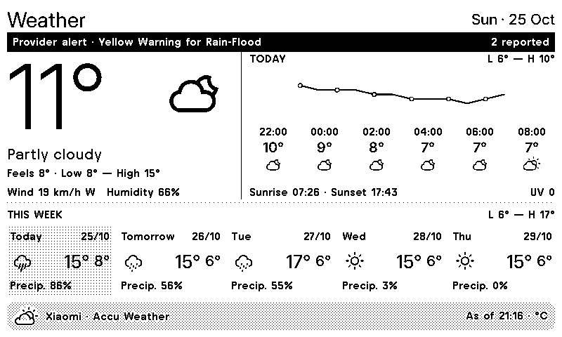

# Xiaomi Weather

Current conditions and forecasts on your TRMNL, using the same weather endpoint as Xiaomi phones. See the temperature, hourly trend, five-day outlook and provider-reported alerts with TRMNL's official weather icons.

<a href="https://github.com/taichikuji/trmnl-xiaomi-weather-plugin/tree/main/TRMNL#setup"></a>

[Set up a Private Plugin](TRMNL#setup)



Recorded Barcelona weather from 4 October 2026, not a current forecast. [All layout previews](TRMNL#previews).

## Settings

- **Location:** search for a city, address or postal code, or enter latitude, longitude.
- **Temperature unit:** Celsius or Fahrenheit (defaults to Celsius).
- No personal weather API key or separate server needed. Private plugins require TRMNL Developer or BYOD access.

Full shows current conditions, the hourly trend, five daily forecasts, wind, humidity, sun times and UV. Half layouts keep current weather and three daily forecasts; quadrant keeps the essentials. All four layouts adapt to TRMNL OG and TRMNL X, including portrait. Data refreshes every 30 minutes.

## Develop locally

Install [trmnlp](https://github.com/usetrmnl/trmnlp) 0.16.0 or newer with Node Serverless support. Set `custom_fields.lat_lon` in [TRMNL/.trmnlp.yml](TRMNL/.trmnlp.yml) to a public demo location such as `48.8584,2.2945`, then run from the repository root:

```sh
cd TRMNL
trmnlp serve
```

Templates and settings live in [TRMNL/src/](TRMNL/src/). See the [plugin guide](TRMNL) for installation and verification, and the [API notes](docs/api-overview.md) for request examples and data limits.

Weather data is provided by AccuWeather via Xiaomi in the tested locations; displayed attribution follows the returned provider.

[Questions or ideas?](https://github.com/taichikuji/trmnl-xiaomi-weather-plugin/issues) · [License](LICENSE)
