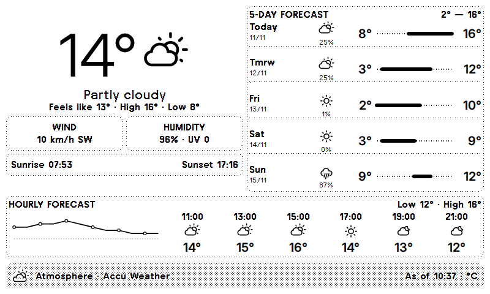

# Atmosphere

Atmosphere (formerly Xiaomi Weather) displays current conditions and forecasts on your TRMNL, using the same weather endpoint as Xiaomi phones. See the temperature, hourly forecast, five-day outlook and provider-reported alerts with TRMNL's official weather icons.

<a href="https://trmnl.com/recipes/495797"></a>

[Install on TRMNL](https://trmnl.com/recipes/495797)



Recorded weather for the public Paris demo point (`48.8584,2.2945`) observed 12 November 2026 at 15:37 CET, not a current forecast. [All layout previews](TRMNL/README.md#previews).

The listing description is **Xiaomi Weather forecasts**. See [listing metadata](TRMNL/README.md#listing-metadata) for TRMNL's search limitations.

## Settings

- **Location:** search for a city, address or postal code, or enter latitude, longitude.
- **Temperature unit:** Celsius or Fahrenheit (defaults to Celsius).
- No personal weather API key or separate server needed.

Full shows current conditions, up to twelve consecutive hourly entries (eight on OG portrait), five daily forecasts, wind, humidity, sun times and UV. Half layouts keep current weather and three daily forecasts; quadrant keeps the essentials. All four layouts adapt to TRMNL OG and TRMNL X, including portrait. Data refreshes every 30 minutes.

## Develop locally

Install the latest [trmnlp](https://github.com/usetrmnl/trmnlp) release, matching the publishing workflow. Weather uses native polling and Liquid formatting, with no Serverless runtime. Set `custom_fields.lat_lon` in [TRMNL/.trmnlp.yml](TRMNL/.trmnlp.yml) to a public demo location such as `48.8584,2.2945`, then run from the repository root:

```sh
cd TRMNL
trmnlp serve
```

Templates and settings live in [TRMNL/src/](TRMNL/src/). See the [plugin guide](TRMNL/README.md) for installation and manual verification, and the [API notes](docs/api-overview.md) for request examples and data limits.

Weather data is provided by AccuWeather via Xiaomi in the tested locations; displayed attribution follows the returned provider.

[Questions or ideas?](https://github.com/taichikuji/trmnl-xiaomi-weather-plugin/issues) · [License](LICENSE)
