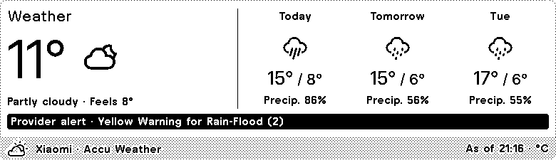
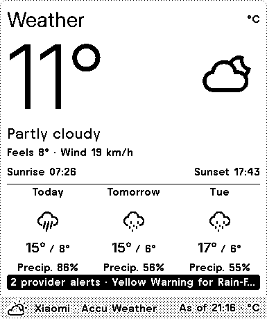
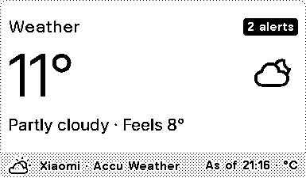

# TRMNL Xiaomi Weather Plugin

Xiaomi Weather displays current conditions and forecasts with native TRMNL typography and [TRMNL's official weather SVGs](https://help.trmnl.com/en/articles/11823386-weather-icons). Choose **Location** with TRMNL’s searchable `lat_lon` picker: search for a city, address or postal code, or enter decimal coordinates. Weather is fetched directly using the selected coordinates. The heading reads **Weather** because the forecast response does not include a city name. No separate server or personal weather API key is required.

## Icon

The plugin listing icon uses the supplied sun-and-cloud artwork, simplified to one path and centered on a square 512 × 512 canvas with a small side margin in TRMNL orange (`#E76F55`), stored in the bundle and referenced from `settings.yml`. Each layout's title bar embeds the same artwork in black (`#000000`). Weather condition icons load from TRMNL's hosted pack, with clear and partly cloudy night variants and the official unavailable icon for unknown codes.

<div align="center">
  
</div>

## Previews

Previews were rendered before the native Liquid migration with a recorded response for the public Paris demo point (`48.8584,2.2945`), observed **25 October 2026 at 21:16 CET**. Regression checks preserve the displayed weather and layout markup. These are not a current forecast. All four use Framework **3.4.0** and the OG 1-bit palette; partial layouts are cropped to their native view.

| Full View | Half Horizontal View |
|------------|----------------------|
|  |  |

| Half Vertical View | Quadrant View |
|-------------------|----------------|
|  |  |

## Setup

Create a TRMNL Private Plugin with Polling / GET, Framework **3.4.0**, screen padding enabled and a **30-minute** refresh interval. Private plugins require Developer or BYOD access.

Use [TRMNLP](https://github.com/usetrmnl/trmnlp) **0.16.0 or newer**, open this directory and run:

```sh
trmnlp serve
```

Set `custom_fields.lat_lon` in `.trmnlp.yml` to a public demo point such as `48.8584,2.2945` before local previewing. The committed value is intentionally blank. Native polling fetches weather directly using the selected coordinates; Shared Liquid validates the coordinates and formats the response. No Serverless runtime is required. Once ready to upload, authenticate and push to your own plugin:

```sh
trmnlp login
trmnlp push --id YOUR_PLUGIN_SETTING_ID
```

With a scoped `trmnl_...` account key, interactive `trmnlp login` needs **Profile** access and uploading needs **Content** access. **Read** is needed only for commands such as `list` and `pull`. CI supplies the key through `TRMNL_API_KEY` instead of logging in, so it can use a Content-only key restricted to this plugin.

Alternatively, copy `src/settings.yml` into the matching dashboard settings, paste `shared.liquid` into Shared and each layout into its matching markup tab. Leave **Serverless** disabled. Force Refresh, check the preview and add the plugin to your playlist.

When upgrading a Serverless installation, upload the settings and markup together. Keep `serverless_language: none` in `settings.yml`: it explicitly removes the hosted script, including with CI's `push --force`. Deleting a local script alone does not remove its hosted copy. For a manual dashboard upgrade, disable Serverless and clear its old script before refreshing. Existing Location and Temperature unit selections remain valid. Installations from the older city/Coordinates fields must select Location again.

The GitHub **Publish to TRMNL** workflow runs when changes to `TRMNL/src/`, `TRMNL/media/` or the workflow file are pushed to `main`. You can also run it manually from Actions. To configure it:

1. Open [Account > Developer](https://trmnl.com/account/developer/edit) and create an **Account API key**, such as `Xiaomi Weather GitHub Actions`.
2. Enable **Content** only. Under Access control, choose **Only specific devices and plugin settings** and grant access to this weather plugin setting. The workflow updates an existing plugin; it does not need Profile, Read, Devices, Delete or Apps permissions.
3. Copy the new `trmnl_...` key into the repository's [Actions secrets](https://github.com/taichikuji/trmnl-xiaomi-weather-plugin/settings/secrets/actions) as `TRMNL_API_KEY`. Replace the old secret if it exists; do not include `Bearer` in the secret value.
4. Set `TRMNL_PLUGIN_SETTING_ID` to the number in your plugin's `/plugin_settings/<ID>/edit` URL. This is the installed plugin setting ID, not a recipe or device ID.
5. Run **Publish to TRMNL** once to verify access. Subsequent pushes to `main` publish automatically when the relevant files change.

The workflow uses the official `trmnl/trmnlp:v0.16.0` image and passes the key through `TRMNL_API_KEY`; TRMNLP adds the Bearer header. No CI login step or separate OAuth flow is needed. A missing capability or plugin access produces a TRMNL 403: recreate the key for a missing capability, or edit its access for a missing plugin grant. See [Account API Keys](https://help.trmnl.com/en/articles/11195228-account-api-keys) and [TRMNLP authentication](https://github.com/usetrmnl/trmnlp#authentication).

## Templates

- **shared.liquid**: Validates coordinates and prepares display values, condition icons and SVG chart coordinates from the raw polling response, then captures attribution, unavailable-data state, provider notices and the hourly chart.
- **full.liquid**: Current conditions, hourly temperatures, five daily forecasts, wind, humidity, sun times and UV.
- **half_horizontal.liquid**: Current weather beside three daily forecasts and a provider notice.
- **half_vertical.liquid**: Large current temperature, sun times, three daily forecasts and a provider notice.
- **quadrant.liquid**: Current temperature, condition, feels-like temperature and alert count; X also shows wind, humidity, daily high/low, precipitation and sun times.

All four layouts use Framework 3.4.0 utilities without custom CSS. Their OG areas are 800 × 480, 800 × 240, 400 × 480 and 400 × 240; X uses the corresponding portions of 1040 × 780, or 780 × 1040 in portrait. The full portrait view stacks current conditions and hourly weather, with three columns for the daily forecasts. Platform margins and title bars reduce the usable content area.

## Public recipe submission

Reviewed against [TRMNL's publishing best practices](https://trmnl.com/blog/plugin-recipe-publishing-tips):

- Xiaomi provides a distinct data source; all four layouts ship in one recipe.
- The About section links to setup instructions and the GitHub repository for support, with the environment category. Settings contain no personal defaults or weather credentials.
- Polling fetches weather directly using the picker’s coordinates. Markup uses native Framework classes and Liquid, a shared embedded title-bar icon, and an SVG chart without chart libraries or client-side API calls.
- Chromium checks covered all four views on OG landscape, X landscape and X portrait, including Fahrenheit, long names, stale observations and unavailable forecasts. Narrow title bars clamp their title while reserving room for observation time and unit.

Before submitting in TRMNL, choose a public demo location such as Paris with the picker, save and Force Refresh. Confirm that the install preview shows weather for the selected location, and save both a search selection and direct coordinates plus each temperature unit to check the account-side form behavior. Run CHEF and address any feedback before acknowledging the practices. Keep the Recipe Master configured for public demo weather and install a separate copy for personal use. These account-side steps and the human review are not confirmed by a successful GitHub upload.

The original design, parsing logic and markup are also available under **CC BY 4.0** in [LICENSE](../LICENSE), matching [TRMNL's public plugin license](https://trmnl.com/plugin-license). Support is available through the About section's GitHub issue link.

CHEF may flag these intentional choices:

- **Title bar include:** every layout outputs `weather_footer`, captured in `shared.liquid`. It contains the [standard native title bar](https://trmnl.com/framework/docs/3.4/title_bar), including our icon, provider attribution, observation time and unit; a separate render include is unnecessary.
- **Image dithering:** all display images are monochrome SVG icons. [TRMNL documents `image-dither` for raster images](https://trmnl.com/framework/docs/3.4/image); no photos or color raster images need conversion here.

## Choose a location

The required **Location** field uses TRMNL’s [native `lat_lon` picker](https://help.trmnl.com/en/articles/10513740-custom-plugin-form-builder#h_07a70ff721). Search for a city, address or postal code and select a match, or enter decimal degrees in **latitude, longitude** order, for example `48.8584,2.2945` (a public landmark in Paris). Latitude must be between −90 and 90 and longitude between −180 and 180. There is no personal default.

TRMNL stores the selection as comma-separated coordinates. Native polling calls Xiaomi’s `/weather/all` endpoint directly, without a location key or lookup request. Shared Liquid validates the coordinates and formats the forecast. The forecast response has no city name, so the heading reads **Weather**.

When upgrading from the removed city and Coordinates fields, choose Location again; those older values are not migrated automatically. Invalid coordinates and unavailable forecasts show an unavailable state. Temperature unit defaults to Celsius and accepts `celsius` or `fahrenheit`.

## Data behavior

- [Verified API mapping](../docs/api-overview.md) records live request comparisons, parameter behavior, request examples and the captured `301` rain regression.
- Xiaomi supplied five daily forecasts and 23 hourly entries for Barcelona despite a seven-day request. The plugin shows returned data only, sampling up to six points across the next 12 hours.
- The observation time remains visible. Observations older than three hours are marked as old data when rendered; elapsed hourly entries are removed.
- Missing optional values display an em dash. Missing current temperature produces an explicit unavailable state. Missing precipitation is never reported as 0%.
- European air-quality fields were unavailable and are omitted. Attribution follows the returned provider, AccuWeather via Xiaomi in the tested cities.
- Alerts are **provider-reported** titles/counts. Xiaomi supplied no structured expiration fields, so the plugin does not determine whether a warning is still in effect. Consult the provider for details.
- Local times preserve the API's UTC offset and hourly wind timestamps when supplied. Without those timestamps, a forecast crossing a DST transition may need a subsequent refresh for corrected hour labels.
- Condition codes follow the [documented network mapping](../docs/condition-codes.md), including `301` rain, `302` snow and source-backed fog/haze extensions. Unknown codes retain the unavailable icon. Xiaomi's Android content-provider code table describes a different interface.

## Verification and references

Run the offline regression checks from this directory using the same official image as publishing:

```sh
docker run --rm --network none \
  --volume "$PWD:/plugin:ro" --entrypoint ruby \
  trmnl/trmnlp:v0.16.0 /plugin/tests/check.rb
```

The native Ruby Liquid checks compare 46 fixed-clock fixtures and all four rendered layouts with the pre-removal baseline, plus 60 condition inputs in day and night modes. Coverage includes coordinate boundaries, both units, negative rounding, missing/invalid data, partial forecasts, alerts and escaping, observation-age boundaries, hourly sampling, chart coordinates, timezone offsets and a DST transition. They also verify that Serverless is disabled and no transform is included in upload inputs. See [test fixture provenance](tests/README.md).

The refactor follows TRMNL's [Shared preprocessing guidance](https://help.trmnl.com/en/articles/13216853-reusing-markup-with-shared) and [documented filters](https://help.trmnl.com/en/articles/10347358-custom-plugin-filters). Helpers use explicit render arguments, serialize strings with `json`, preserve null/zero distinctions with `parse_json`, and escape provider text at the HTML boundary. The four layout templates and Framework version remain unchanged. Local development checks use Ruby; the installed plugin needs only native polling and Liquid.

Account-side autocomplete, form validation, scheduled refresh, CHEF and physical e-ink output still require verification in TRMNL.

Design research included [Weather Glance](https://trmnl.com/recipes/181200), the [Extended Weather Dashboard](https://github.com/Baszert/trmnl-extended-weather-dashboard), TRMNL's [native weather fixture](https://github.com/usetrmnl/trmnl-framework/blob/main/public/framework/example_fixtures/weather/full.html), and the [official TRMNL agent skill](https://github.com/usetrmnl/trmnl-agent-skills). Reference application source was not copied.

The official skill can be used directly from its upstream repository. Optional MCP access uses `https://trmnl.com/mcp` with OAuth, or a plugin MCP key from its MCP tab. The account REST API key is not an MCP key. No MCP credentials are stored in this project.
